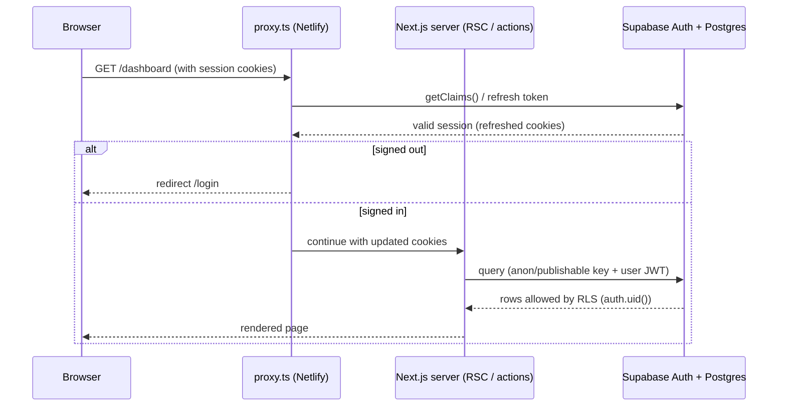
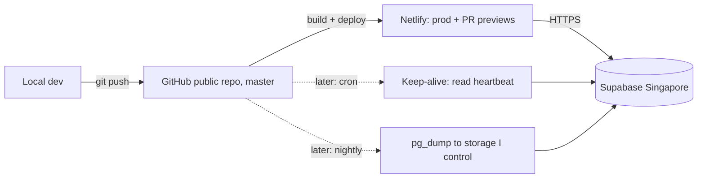

# Architecture

## Stack
- **Next.js 16** (App Router, React 19, TypeScript, Tailwind v4). `proxy.ts` replaces `middleware.ts`, and `cacheComponents` is on, so request-time data (cookies, session) must be read inside `<Suspense>` or dynamic code paths. See `node_modules/next/dist/docs/`.
- **shadcn/ui** (Radix base, `new-york`), with tokens in `src/app/globals.css`. Light only.
- **Supabase**: Postgres + Auth + RLS + Storage, accessed via `@supabase/ssr` ([Next.js SSR guide](https://supabase.com/docs/guides/auth/server-side/nextjs)).
- **Netlify**: builds from GitHub, with deploy previews on PRs.

## Folder layout
```
src/
  app/                 # routes (App Router)
    (auth)/            # planned: login, register, forgot-password, reset-password
    auth/confirm/      # planned: email link handler (route handler)
    dashboard/         # planned: protected area
    globals.css        # theme tokens
    icon.png           # favicon from the logo
  components/
    ui/                # shadcn components (generated, editable)
  lib/
    utils.ts           # cn()
    supabase/          # planned: client.ts (browser), server.ts (server), proxy.ts (session refresh)
  proxy.ts             # planned: session refresh + route protection
public/brand/          # logo
docs/                  # these docs
supabase/              # Supabase CLI: config.toml (local stack) + migrations/
```

## Request and auth flow


## Data and security
- Only the **publishable/anon key** is used in the app (`NEXT_PUBLIC_*`). RLS does the authorization.
- Every table has **RLS on** and policies scoped to `auth.uid()`.
- The service_role/secret key is used only in GitHub Actions secrets (backup jobs), never in the app.
- The repo is **public**: Actions logs and artifacts are public too, so backup jobs must never print data or upload dumps as artifacts.

## Deployment and ops

