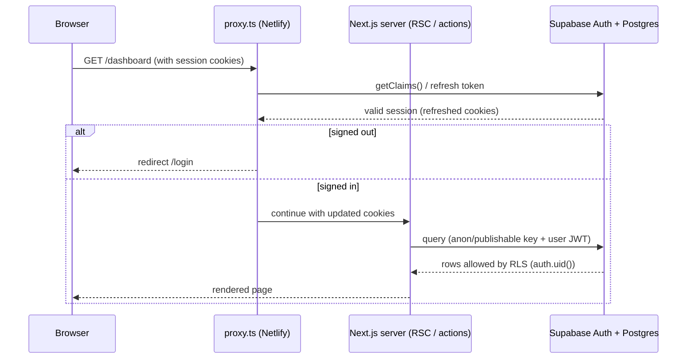
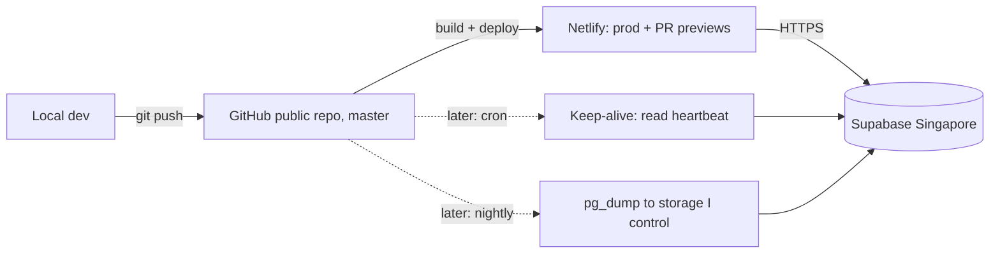
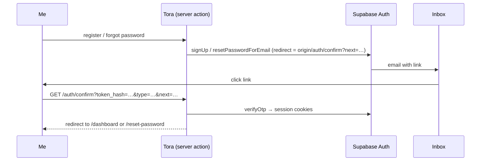

# Architecture

## Stack
- **Next.js 16** (App Router, React 19, TypeScript, Tailwind v4). `proxy.ts` replaces `middleware.ts`, and `cacheComponents` is on, so request-time data (cookies, session) must be read inside `<Suspense>` or dynamic code paths. See `node_modules/next/dist/docs/`.
- **shadcn/ui** (Radix base, `new-york`), with tokens in `src/app/globals.css`. Light only.
- **Supabase**: Postgres + Auth + RLS + Storage, accessed via `@supabase/ssr` ([Next.js SSR guide](https://supabase.com/docs/guides/auth/server-side/nextjs)).
- **Netlify**: builds from GitHub, with deploy previews on PRs.

## Folder layout
```
src/
  app/                 # routes (App Router)
    (auth)/            # login, register, forgot-password, reset-password + actions.ts (server actions)
    auth/confirm/      # email link handler: verifyOtp(token_hash) or exchangeCodeForSession(code)
    (app)/             # signed-in area: sidebar shell (layout.tsx) + dashboard, accounts, transactions,
                       # cash-flow, budgets, recurring, goals, reports, settings
    globals.css        # theme tokens
    icon.png           # favicon from the logo
  components/
    app/               # shell: sidebar, header, nav, confirm dialog, form helpers
    accounts/ transactions/ settings/   # feature components (dialogs, lists, filters)
    auth/              # auth forms (client components using useActionState)
    ui/                # shadcn components (generated, editable)
  lib/
    utils.ts           # cn()
    money.ts           # formatMoney() / parseAmount(): Intl, id-ID style
    data/queries.ts    # server-side reads (accounts + balances, categories, transactions)
    finance/           # types, account type labels, dates (Asia/Jakarta), form helpers
    supabase/          # server.ts (server client), proxy.ts (session refresh)
    auth/              # friendly error messages, origin + safe redirect helpers
  proxy.ts             # session refresh + route protection
public/brand/          # logo
docs/                  # these docs
supabase/              # Supabase CLI: config.toml (local stack) + migrations/
```

## Request and auth flow


## Data and security
- Only the **publishable/anon key** is used in the app (`NEXT_PUBLIC_*`). RLS does the authorization.
- Every table has **RLS on** and policies scoped to `auth.uid()`.
- The service_role/secret key is used only in GitHub Actions secrets (backup jobs), never in the app.
- The repo is **public**: Actions logs and artifacts are public too, so backup jobs must never print data or upload dumps as artifacts.

## Deployment and ops


## Auth routing (proxy.ts)
| Path | Signed out | Signed in |
|---|---|---|
| `/` | → `/login` | → `/dashboard` |
| `/login`, `/register`, `/forgot-password` | show | → `/dashboard` |
| everything else (app pages, `/reset-password`, unknown paths) | → `/login` | show |
| `/auth/*` (public) e.g. `/auth/confirm` | verifies the email link, then → `next` (relative paths only) or `/login?error=link_invalid` | same |

Email links come back to the origin that sent them (localhost, a deploy preview, or production), via `getOrigin()`. No domain is hard-coded.


