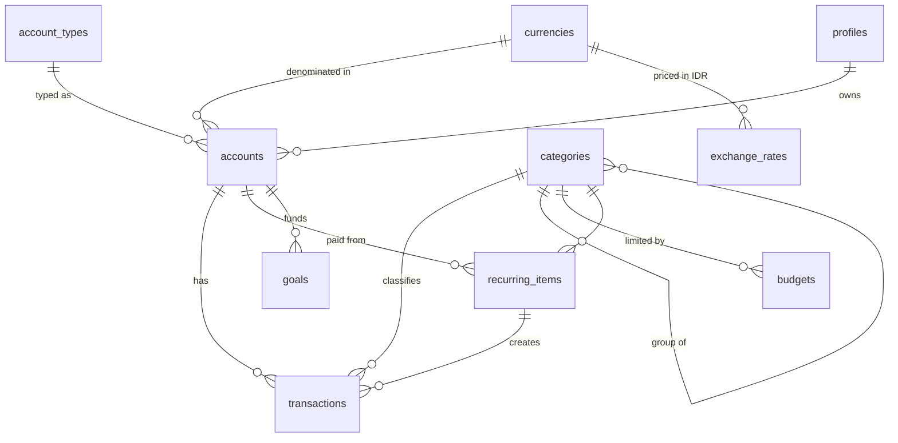

# Data model

Postgres on Supabase. Every user-owned table has `user_id` (defaults to `auth.uid()`), **RLS on**, and one owner-only policy. Composite foreign keys `(x_id, user_id)` stop a row from pointing at another user's account or category.

## Rules
- **Money** is `numeric(18,2)` (exact decimal, never float), in the account's currency. `currencies.decimals` controls display only (IDR shows 0 decimals).
- **Amounts are signed.** Money in is positive, money out is negative. Account balance = `opening_balance + sum(transactions.amount)` (view `account_balances`).
- **Account types** are user-managed (Settings → Account types; 10 defaults). Each has a **class**: `cash` (Cash & bank), `investment` (Investments & property), or `liability` (Debts). The class can't change while accounts use the type, and an account can't move between a debt type and an asset type.
- **Debts** (class `liability`: credit card, paylater, loan) have negative balances. Net worth = the sum of all balances where `include_in_net_worth`.
- **Transaction kinds:**
  - `regular`: income or spending, categorized. A refund is a positive amount in an expense category, so it reduces spending.
  - `transfer`: two rows (one per account) sharing a `transfer_id`. Excluded from cash flow.
  - `adjustment`: balance corrections and investment/property revaluations. Excluded from cash flow.
- **Time** on transactions is optional (`time`), used to order within a day.
- **Categories** have two levels: a group (`parent_id` null) and its categories. Kind is `expense` or `income`. New users get a default set.
- **Budgets:** one amount per category per month (`month` = first day of the month), in the base currency.
- **Recurring items:** expected signed amount, frequency (`daily`, `weekly`, `monthly`, `yearly`) × `interval_count`, and `next_due_date`.
- **Goals:** a target amount and optional date. Progress = the linked account's balance, or `saved_amount` if no account is linked.
- **Exchange rates:** one latest rate per foreign currency per user (`1 CODE = rate IDR`), typed by hand or fetched from open.er-api.com. Totals (net worth, cash flow, budgets) convert with today's rate; currencies without a rate are left out and flagged in the UI.
- **CSV imports:** imported rows share an `import_id`, so an import can be reviewed or undone at once. Duplicates (same account, date, amount, description) are skipped by default.
- **Two-factor login:** once a user has a verified authenticator (TOTP factor), a restrictive policy "Require 2FA when enabled" on every user table (via `public.mfa_satisfied()`) only allows sessions at `aal2`. Users without 2FA are unaffected.
- **Profiles:** one per user (base currency `IDR`, timezone `Asia/Jakarta`), created by a trigger on sign-up.

## Not yet (ideas)
- Historical exchange rates (today's rate is used for every month)
- Investment holdings (ticker, units, price)
- Tags, attachments (Supabase Storage), split transactions
